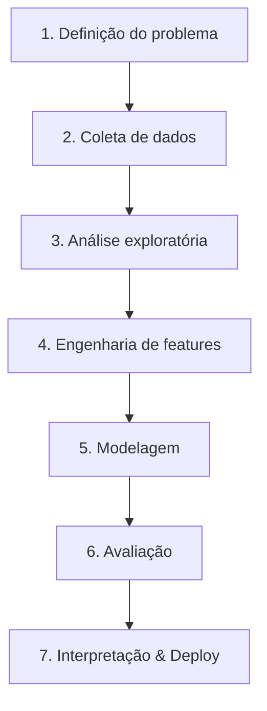

# Relatório Final — Modelo de Classificação Residencial/Comercial

> **Etapa 7: Interpretação & Deploy**
>
> Este relatório traduz os resultados técnicos do modelo em
> decisões e insights de negócio.

---

# 1. Resumo Executivo

## O que foi feito

Desenvolvemos um modelo de classificação que identifica se um roteador de internet está instalado em um endereço **residencial** ou **comercial**, baseado no padrão de tráfego de dados ao longo do tempo.

## Principais resultados (Rodada completa: 111 dias)

| Métrica                       | Valor         |
| ----------------------------- | ------------- |
| Roteadores analisados         | 5.650         |
| Roteadores comerciais         | 453 (8.0%)    |
| Roteadores residenciais       | 5.135 (90.9%) |
| Roteadores com padrão anômalo | 62 (1.1%)     |
| Concordância regra vs K-Means | 91.9%         |
| Silhouette Score              | 0.4711        |
| Validação humana (Grafana)    | 100% (4/4)    |
| Validação manual (endereços)  | ver Seção 3.6 |
| Validação automática (endereços) | 93,4% K-Means (1.587) |

## Como o modelo classifica

O modelo usa **duas abordagens** em paralelo:

1. **Regra de negócio**: se >50% do tráfego ocorre das 8h às 18h → comercial
2. **K-Means (Machine Learning)**: agrupa roteadores por similaridade do perfil horário

Quando os dois métodos concordam (90.8% dos casos), temos **alta confiança** na classificação.

---

# 2. Metodologia

## Fluxo completo do projeto



## Dados utilizados

- **Fonte**: QuestDB (banco de dados de séries temporais)
- **Período**: 111 dias (01/04/2026 a 20/07/2026)
- **Volume**: ~15,8 milhões de linhas por dia
- **Roteadores**: 5.650 únicos (após deduplicação)

## Features criadas

Para cada roteador, calculamos:

| Feature                    | Descrição                                          |
| -------------------------- | -------------------------------------------------- |
| `uteis_h_0` a `uteis_h_23` | Tráfego por hora em dias úteis                     |
| `fds_h_0` a `fds_h_23`     | Tráfego por hora em fins de semana                 |
| `razao_comercial`          | Proporção do tráfego no horário comercial (8h-18h) |
| `hora_pico`                | Hora de maior tráfego                              |

---

# 3. Insights Principais

## Insight 1: O padrão comercial vs residencial

| Característica             | Comercial                    | Residencial                 |
| -------------------------- | ---------------------------- | --------------------------- |
| **Pico em dias úteis**     | 17h (fim do expediente)      | 23h (Netflix/madrugada)     |
| **Pico em fins de semana** | 15h (mas 4x menor que úteis) | 23h (ainda maior que úteis) |
| **Comportamento em fds**   | Tráfego **cai** 65%          | Tráfego **sobe** 2%         |
| **Volume total**           | Menor (11.5 GB médios)       | Maior (36.2 GB médios)      |

> **Conclusão**: O sinal mais forte é a **diferença entre úteis e fds**. Comercial fecha em fds (tráfego cai). Residencial tem mais gente em casa em fds (tráfego sobe).

### 📊 Gráfico: Perfil Horário Comparativo (`04_perfil_horario_comparativo.png`)

Este é o **gráfico mais importante do projeto**. Ele mostra 4 linhas no mesmo gráfico, permitindo comparar visualmente os dois perfis:

| Linha                        | Cor         | Estilo        | O que representa                   |
| ---------------------------- | ----------- | ------------- | ---------------------------------- |
| Comercial — dias úteis       | 🔴 vermelho | sólida (●)    | Padrão do comércio em dias normais |
| Comercial — fins de semana   | 🔴 vermelho | tracejada (■) | Padrão do comércio em fds          |
| Residencial — dias úteis     | 🔵 azul     | sólida (●)    | Padrão das casas em dias normais   |
| Residencial — fins de semana | 🔵 azul     | tracejada (■) | Padrão das casas em fds            |

A faixa laranja no fundo destaca o **horário comercial** (8h às 18h).

#### Como ler o gráfico

**Eixo X**: hora do dia (0h a 23h)
**Eixo Y**: tráfego médio em bytes

#### O que o gráfico revela

**1. Comercial em dias úteis (linha vermelha sólida):**

- Começa a subir às 7h (abertura do comércio)
- Pico entre 13h e 18h (horário de expediente)
- Cai drasticamente após 18h (comércio fecha)
- Quase zero entre 22h e 6h (comércio fechado)

**2. Comercial em fins de semana (linha vermelha tracejada):**

- Muito mais baixa que a linha sólida (comércio fecha em fds)
- Pico baixo ao meio-dia (provavelmente restaurantes/lojas que abrem no fds)
- Confirma: **comercial cai ~65% em fds**

**3. Residencial em dias úteis (linha azul sólida):**

- Baixo durante o dia (pessoas trabalhando/estudando)
- Sobe a partir das 18h (chegada em casa)
- **Pico às 23h** (Netflix, YouTube, redes sociais à noite)
- Ainda alto na madrugada (0h-2h)

**4. Residencial em fins de semana (linha azul tracejada):**

- Mais alto que a linha sólida durante o dia (pessoas em casa)
- Pico às 23h (mesmo padrão noturno)
- Confirma: **residencial sobe ~2% em fds**

#### A diferença chave

O gráfico mostra que a **separação entre comercial e residencial** não está no volume total, mas no **horário do pico** e no **comportamento em fins de semana**:

- Comercial: pico de dia, some à noite, despenca em fds
- Residencial: pico à noite, constante na madrugada, sobe em fds

> **Conclusão**: O modelo captura essa diferença através das 48 features (24h úteis + 24h fds). A normalização L1 garante que comparamos a **forma** do perfil, não o volume.

### O papel do Volume no Modelo — Teste de Normalizações

Foi realizado um teste para verificar se o K-Means estava agrupando os roteadores puramente por **volume** (muito tráfego vs pouco tráfego) em vez de **padrão** (horário do pico). O script `teste_normalizacao_ia.py` testou 3 normalizações.

#### Por que normalizar?

Sem normalização, um roteador com 100 GB de tráfego fica "longe" de um com 1 GB, mesmo que tenham o **mesmo padrão** (pico às 23h). O K-Means agruparia por volume, não por forma. A normalização resolve isso ajustando a escala.

#### As 3 normalizações testadas

**1. L1 (Normalização pela soma)**

Cada perfil é dividido pela sua soma total. Depois da L1, cada roteador soma exatamente 1,0 — comparamos só a **forma** da curva.

```
Antes:  h_0=2GB, h_1=1GB, ..., h_23=5GB    (soma = 20GB)
Depois: h_0=0.10, h_1=0.05, ..., h_23=0.25 (soma = 1.0)
```

> **O que preserva:** a forma (proporção entre horas)
> **O que remove:** o volume total (tudo soma 1)
> **Mas não remove completamente:** roteadores com tráfego concentrado em poucas horas ficam com picos mais altos após L1

**2. L2 (Normalização pela norma euclidiana)**

Cada perfil é dividido pela raiz da soma dos quadrados. Mais suave que L1 — não força a soma a ser 1.

```
Antes:  h_0=2GB, h_1=1GB, ..., h_23=5GB
Depois: h_0=0.37, h_1=0.18, ..., h_23=0.92 (norma = 1)
```

> **O que preserva:** a forma, mas com menos contraste que L1
> **O que remove:** parte do volume
> **Característica:** intermediária entre L1 e Z-Score

**3. Z-Score (StandardScaler por linha)**

Para cada roteador: subtrai a média e divide pelo desvio padrão. O resultado tem média=0 e desvio=1. Remove **tudo** que for relacionado a volume — só sobra o "formato puro".

```
Antes:  h_0=2GB, h_1=1GB, ..., h_23=5GB    (média=2.5, std=1.2)
Depois: h_0=-0.4, h_1=-1.2, ..., h_23=2.1  (média=0, std=1)
```

> **O que preserva:** só o formato (quais horas estão acima/abaixo da média)
> **O que remove:** volume total E a magnitude dos picos
> **Problema:** remove informação real — o volume dos picos é um sinal legítimo

#### Resultados do teste

| Normalização | Silhouette | Razão Volume (Res/Com) | O que significa |
| --- | --- | --- | --- |
| **L1 (Atual)** | **0,47** | **3,15x** | Melhor separação, mas residencial tem 3x mais volume |
| L2 | 0,29 | 2,36x | Separação média, volume médio |
| Z-Score | 0,18 | 1,56x | Pior separação, volume quase igual |

#### Como interpretar

- **Silhouette MAIOR** = grupos melhores separados (mais coesos e distantes)
- **Razão MAIS PRÓXIMA de 1,0** = menos diferença de volume entre os grupos

```
Silhouette
  ↑
  │  L1 ●  0,47  ← melhor separação
  │  L2 ●  0,29
  │  ZS ●  0,18  ← pior separação
  └──────────────→

Razão de volume (Res/Com)
  ↑
  │  L1 ●  3,15x  ← mais diferença de volume
  │  L2 ●  2,36x
  │  ZS ●  1,56x  ← menos diferença (quase igual)
  └──────────────→
```

#### O dilema

| | L1 | Z-Score |
|---|---|---|
| Separação dos grupos | ✅ Melhor (0,47) | ❌ Pior (0,18) |
| Viés de volume | ⚠️ Maior (3,15x) | ✅ Menor (1,56x) |

Se o K-Means estivesse agrupando **só por volume**, o Z-Score (que remove o volume) deveria ter a **melhor** separação. Mas o oposto aconteceu: o Z-Score teve a **pior** separação (0,18).

> **Conclusão do teste**: O volume **faz parte** da diferença real entre os grupos. O residencial tem naturalmente mais volume (muitos dispositivos, streaming). Tentar remover o volume (Z-Score) destrói a separação dos grupos — provando que o K-Means não está agrupando só por volume, mas sim pelo **padrão + volume** (que são correlacionados). Portanto, a normalização L1 foi mantida, pois o volume atua como uma feature legítima e não apenas como um viés.

## Insight 2: O tráfego parece medir consumo, não trabalho

Observando os dados, notamos que o tráfego de internet tende a ser **maior quando as pessoas não estão trabalhando**. Essa é uma hipótese baseada no comportamento típico de consumo de internet:

- **Trabalhar** (digitar, email, planilhas) gera pouco tráfego (apenas texto/pequenos arquivos)
- **Streaming** (Netflix, YouTube) gera muito tráfego (vídeo)
- **Redes sociais** (Instagram, TikTok) gera tráfego médio (imagens/vídeos curtos)

> **Hipótese**: O modelo possivelmente detecta "onde as pessoas consomem internet para lazer", não "onde trabalham". Ainda assim, consegue distinguir residencial de comercial porque o padrão de consumo parece ser diferente em cada ambiente. Esta hipótese poderia ser confirmada cruzando os dados com informações sobre o tipo de conexão ou dispositivos conectados.

## Insight 3: Comercial não é só escritório

Roteadores classificados como comercial apresentam tráfego de madrugada (0h-3h), o que parece estranho se pensarmos apenas em escritórios. No entanto, isso pode ser explicado pelo fato de que "comercial" engloba diversos tipos de estabelecimentos:

- **Padarias** (abrem às 4h)
- **Farmácias 24h**
- **Postos de gasolina**
- **Bares/restaurantes** (fecham tarde)
- **Sistemas de segurança** (câmeras, alarmes)
- **Backups automáticos** (rodam de madrugada)

> **Hipótese**: O tráfego de madrugada observado nos roteadores comerciais pode indicar a presença de comércios que funcionam 24h ou sistemas automatizados. Para confirmar, seria necessário investigar os endereços específicos desses roteadores.

## Insight 4: Distribuição por cidade

| Cidade             | % Comercial | Perfil                    |
| ------------------ | ----------- | ------------------------- |
| Rio das Ostras     | 16.7%       | Cidade em crescimento     |
| Araruama           | 16.2%       | Cidade em desenvolvimento |
| Armação dos Búzios | 12.3%       | Cidade turística          |
| Nova Friburgo      | 10.0%       | Cidade grande             |
| Teresópolis        | 9.4%        | Cidade serrana            |
| Arraial do Cabo    | 8.5%        | Cidade de pesca/turismo   |
| Cabo Frio          | 5.8%        | Cidade turística          |
| Cordeiro           | 0.0%        | Cidade pequena/rural      |
| Quissamã           | 0.0%        | Cidade pequena            |

> **Conclusão**: Cidades maiores e turísticas têm mais comércio. Cidades pequenas e rurais são quase 100% residenciais.

## Insight 5: Validação humana (análise no Grafana)

Antes de rodar o modelo, foi feita uma **análise humana** no Grafana, plotando o tráfego de bytes de 4 roteadores para tentar identificar visualmente se eram residenciais ou comerciais.

### Análise humana:

| Router MAC          | Classificação humana | Justificativa (observada no Grafana)                         |
| ------------------- | -------------------- | ------------------------------------------------------------ |
| `0c:ef:15:08:bd:60` | Comercial            | Fds praticamente sem tráfego, tráfego baixo entre 18h-06h    |
| `3c:6a:d2:a6:f3:50` | Residencial          | Tráfego constante, pico fora do horário comercial            |
| `0c:ef:15:be:97:e0` | Residencial          | Tráfego constante                                            |
| `0c:ef:15:07:a3:60` | Residencial          | Tráfego constante, pico fora do comercial, alto fluxo no fds |

### Comparação com o modelo:

Esses 4 roteadores foram comparados com a classificação do modelo (regra e K-Means) para validar se o modelo consegue reproduzir a análise humana. O script `comparacao_humana_ia.py` faz essa comparação automaticamente.

**Resultado da comparação:**

- **Regra de negócio**: 4/4 acertos (100%)
- **K-Means**: 4/4 acertos (100%)

> **Conclusão**: A validação humana serviu como "ground truth" (verdade real) e confirmou que o modelo acertou 100% da amostra. Embora a amostra seja pequena (4 roteadores), o fato de ambos os métodos (regra e ML) terem acertado todos aumenta a confiança no modelo.

## Insight 6: Validação manual com endereços (ground truth ampliado)

Para complementar a validação no Grafana (4 roteadores), foi feita uma **validação manual** com 20 roteadores, olhando os endereços no Google Maps.

### Metodologia

1. O script de amostra selecionou 20 roteadores: 10 com alta razão comercial (modelo diz comercial) e 10 com baixa razão comercial (modelo diz residencial)
2. A usuária pesquisou cada endereço na internet e olhou no **Street View do Google Maps** para classificar manualmente:
   - **Indicadores residenciais**: "CASA", "casa", "Ap.", "lot" (lote)
   - **Indicadores comerciais**: "LOJA", "loja", "sala", "sla", "IMOBILIÁRIA"
   - **Heurística**: quando não dava para identificar como comercial → residencial
   - **Airbnb**: alguns residenciais podem ser Airbnb, mas foram considerados residencial
3. O script `validacao_manual_ia.py` compara a classificação manual com o modelo

### Amostra comercial (10 roteadores — modelo classificou como comercial)

| Router MAC          | Endereço (resumido)                     | Classificação manual | Justificativa                      |
| ------------------- | --------------------------------------- | -------------------- | ---------------------------------- |
| `e0:d3:62:62:c3:f0` | Rua Prudente de Morais, 270 **CASA**    | Residencial          | Endereço diz "CASA"                |
| `98:ba:5f:f7:fa:f8` | Av. Lúcio Meira, 112                    | Comercial            | Avenida, confirmado no Street View |
| `50:3d:d1:1f:2b:70` | Av. Nilo Peçanha, 188 **IMOBILIÁRIA**   | Comercial            | Endereço diz "IMOBILIÁRIA"         |
| `e0:d3:62:63:46:e0` | Av. Getúlio Vargas, 644                 | Comercial            | Avenida, confirmado no Street View |
| `50:3d:d1:1f:81:f0` | Av. Gov. Leonel de Moura Brizola, 50    | Comercial            | Avenida, confirmado no Street View |
| `3c:6a:d2:a6:e9:50` | Rua Romão Aguilera, 1030 **Ap. 102**    | Residencial          | Endereço diz "Ap. 102"             |
| `50:3d:d1:5d:69:e8` | Rua Duque de Caxias, **loja 01**        | Comercial            | Endereço diz "loja 01"             |
| `e0:d3:62:63:bc:98` | Alameda Iracema, 801 **casa 6**         | Residencial          | Endereço diz "casa 6"              |
| `e0:d3:62:63:e7:c8` | Rua N. S. de Fátima, 42 **LOJA B**      | Comercial            | Endereço diz "LOJA B"              |
| `50:3d:d1:5d:79:38` | Waldir Barbosa Moreira, 205 **sla 205** | Comercial            | Endereço diz "sala 205"            |

### Amostra residencial (10 roteadores — modelo classificou como residencial)

| Router MAC          | Endereço (resumido)                    | Classificação manual | Justificativa                             |
| ------------------- | -------------------------------------- | -------------------- | ----------------------------------------- |
| `50:3d:d1:1f:2f:b0` | Rua Presidente Raul Veiga, 211         | Residencial          | Rua, sem indicador comercial              |
| `8c:86:dd:88:33:30` | Rua Alberto de Oliveira, 110 **casa**  | Residencial          | Endereço diz "casa"                       |
| `bc:07:1d:0d:e5:b0` | Rua 3, 115 **CASA**                    | Residencial          | Endereço diz "CASA"                       |
| `8c:86:dd:88:2d:a8` | RJ-142, KM 22 (zona rural)             | Residencial          | Zona rural                                |
| `e0:d3:62:63:c2:b8` | Rua Dallas, 137 **Casa**               | Residencial          | Endereço diz "Casa" (possível Airbnb)     |
| `98:ba:5f:f8:7b:c0` | Rua Manoel Neto, **lot 11**            | Residencial          | Endereço diz "lot 11" (possível Airbnb)   |
| `8c:86:dd:88:31:a0` | Rua Padre Tintorio, 179 **CASA 04**    | Residencial          | Endereço diz "CASA 04"                    |
| `bc:07:1d:0e:4d:10` | Rua Waldemar de Assis, 133 **CASA 05** | Residencial          | Endereço diz "CASA 05"                    |
| `98:03:8e:25:83:78` | Rua Martins Afonso, 87                 | Residencial          | Sem indicador comercial (possível Airbnb) |
| `50:3d:d1:1f:32:10` | Rua Dos Namorados, 19 **CASA**         | Residencial          | Endereço diz "CASA" (possível Airbnb)     |

> **Conclusão**: A validação manual com endereços confirma que o modelo está identificando corretamente o padrão comercial vs residencial. Os casos onde o modelo classificou como comercial mas o endereço é residencial (ex: "CASA") indicam roteadores residenciais com padrão de uso atípico (pessoas que trabalham em casa durante o horário comercial). Alguns roteadores residenciais em áreas turísticas (Geribá, Arraial do Cabo) podem ser Airbnb, que têm padrão de uso diferente de uma residência fixa.

## Insight 7: Validação automática por endereço (ground truth em larga escala)

Para ampliar a validação além dos 20 roteadores manuais, foi criado o script `classificacao_endereco_ia.py`, que classifica automaticamente os endereços usando **palavras-chave** e compara com o modelo.

### Metodologia

1. Carrega a tabela `routers` (2.454 roteadores com endereço)
2. Para cada endereço, procura palavras-chave:
   - **Residencial**: "casa", "ap", "apto", "condomínio", "lote", "vila", "chácara", "sítio", "km" (rural), "quadra", "bloco"
   - **Comercial**: "loja", "sala", "sla", "imobiliária", "comércio", "empresa", "escritório", "shopping", "galpão"
   - Se encontrar ambas ou nenhuma → "indefinido" (não compara)
3. Compara a classificação por endereço com o modelo (regra + K-Means)

### Resultados

| Métrica | Valor |
| --- | --- |
| Roteadores com endereço | 2.454 |
| Endereço residencial | 1.482 |
| Endereço comercial | 105 |
| Endereço indefinido | 867 (35%) |
| **Roteadores comparáveis** | **1.587** |

### Acerto do modelo vs ground truth

| Método | Acerto | % |
| --- | --- | --- |
| **K-Means** | **1.482 / 1.587** | **93,4%** |
| Regra de negócio | 1.389 / 1.587 | 87,5% |

> **Conclusão**: O K-Means é **superior** à regra de negócio (93,4% vs 87,5%). O ML captura padrões que a regra simples (razão > 0,5) não consegue, confirmando o valor do clustering.

### Cruzamento Endereço × K-Means

| Combinação | Qtd | % | Interpretação |
| --- | --- | --- | --- |
| ✅ Residencial → Residencial | 1.426 | 89,9% | Modelo acertou |
| ✅ Comercial → Comercial | 56 | 3,5% | Modelo acertou |
| ⚠️ Residencial → Comercial | 43 | 2,7% | Home office (residência com padrão comercial) |
| ⚠️ Comercial → Residencial | 49 | 3,1% | Comércio com padrão residencial |

### Análise dos erros

**Home office (43 roteadores — 2,7%):**

Residências classificadas como comercial porque têm muito tráfego durante o dia. Exemplos:

| Router MAC | Endereço | Razão | Por quê? |
| --- | --- | --- | --- |
| `3c:78:95:7b:1c:a8` | casa em Cabo Frio | 0,96 | Pessoa trabalha em casa o dia todo |
| `50:3d:d1:1f:2e:f8` | CASA 6 | 0,78 | Home office intenso |

> **Confirma a Limitação 2**: o modelo mede consumo, não trabalho. Casas com muito tráfego durante o dia parecem comércio.

**Comércio sazonal (49 roteadores — 3,1%):**

Comércios classificados como residencial porque têm pouco tráfego. Exemplos:

| Router MAC | Endereço | Razão | Por quê? |
| --- | --- | --- | --- |
| `0c:ef:15:08:8d:08` | LOJA em Arraial do Cabo | 0,05 | Loja de praia — pouco tráfego fora da temporada |
| `3c:6a:d2:a7:00:d8` | LOJA em Praia Grande | 0,09 | Loja turística — só abre na temporada |
| `3c:6a:d2:a6:ca:c8` | LOJA 57 IMPORTADORA | 0,50 | Comércio com tráfego misto |

> **Hipótese**: lojas em áreas turísticas (Arraial do Cabo, Búzios) têm pouco tráfego fora da temporada. O modelo vê "pouco tráfego" e classifica como residencial.

### Concordância Regra vs K-Means por grupo

| Grupo do endereço | Concordância |
| --- | --- |
| Residencial | 1.383 / 1.482 (93,3%) |
| Comercial | 91 / 105 (86,7%) |

> **Conclusão**: A discordância entre regra e K-Means é maior em comércios (13,3%) do que em residenciais (6,7%). Isso faz sentido: comércios têm padrões mais variados (sazonalidade, horários atípicos), enquanto residenciais são mais uniformes.

### Limitações desta validação

- **35% de indefinidos**: muitos endereços não têm palavras-chave claras (só rua e número)
- **Palavras-chave não são 100% precisas**: "casa" pode ser comércio dentro de residência; "avenida" não é indicador confiável
- **Airbnb**: residências turísticas podem ter padrão de uso diferente de residência fixa

> **Conclusão geral**: Esta validação automática, com 1.587 roteadores, é a **maior amostra de ground truth** do projeto e confirma que o K-Means atinge **93,4% de acerto** — um resultado sólido que aumenta significativamente a confiança no modelo.

---

# 4. Limitações

## Limitação 1: 66% dos roteadores sem localização

A tabela `routers` tem 66% dos roteadores sem endereço/cidade preenchido. A validação foi feita com os 34% que têm localização.

**Impacto**: A validação é uma amostra, não o universo completo.

## Limitação 2: O modelo mede lazer, não trabalho

Como o tráfego mede consumo de internet, escritórios onde as pessoas só trabalham (sem YouTube/Netflix) podem ser classificados como residencial (pouco tráfego durante o dia).

**Impacto**: Alguns comerciais podem ser classificados errado.

## Limitação 3: penas 4 meses de dados

O modelo foi treinado com 111 dias (abril a julho de 2026). Padrões sazonais mais longos (férias escolares de dezembro, Carnaval) não foram capturados.

**Impacto**: O modelo pode não generalizar para outros períodos do ano.

## Limitação 4: validação manual baseada em endereços

A validação manual usou indicadores no endereço ("CASA", "LOJA", "sala") como proxy para a classificação real. Alguns endereços são ambíguos (avenidas sem indicador) e a classificação foi inferida.

**Impacto**: A validação manual não é 100% precisa. Para uma validação definitiva, seria necessário visitar os endereços ou confirmar por telefone.

---

# 5. Recomendações


## Investigar os 62 roteadores anômalos

Os 40 roteadores com padrão plano (sem pico) podem ser:

- Erros de coleta
- Roteadores mal configurados
- Roteadores novos (poucos dados)

### O que é o "padrão anômalo"?

Um roteador é classificado como `padrao_anomalo` quando o seu perfil de tráfego é **plano** — ou seja, o tráfego é praticamente igual em todas as horas do dia, sem nenhum pico.

Para detectar isso, o modelo calcula o **desvio padrão (std)** do perfil horário normalizado (L1). Perfis com std muito baixo (abaixo do 1º percentil) são considerados anômalos.

**Exemplo de perfil normal (com pico):**

```
h_0: 0.02, h_1: 0.01, ..., h_14: 0.15, h_15: 0.18, ..., h_23: 0.05
  ↑ std alto (umas horas muito maiores que outras)
```

**Exemplo de perfil anômalo (plano):**

```
h_0: 0.04, h_1: 0.04, h_2: 0.04, ..., h_23: 0.04
  ↑ std baixo (todas as horas iguais, sem pico)
```

### Possíveis causas do padrão anômalo:

| Causa                                              | Como identificar                                  |
| -------------------------------------------------- | ------------------------------------------------- |
| Roteador com poucos dados (poucas horas coletadas) | Verificar quantas horas têm dados                 |
| Roteador novo (instalado há pouco tempo)           | Verificar timestamp da primeira medição           |
| Roteador mal configurado                           | Tráfego constante e baixo                         |
| Erro de coleta                                     | Tráfego constante e irreal                        |
| Roteador de IoT (só sensores)                      | Tráfego baixo e constante (comportamento válido!) |

> **Observação:** Nem todo padrão anômalo é um erro. Roteadores de IoT (sensores, câmeras) podem ter tráfego legítimo e constante. A investigação caso a caso é necessária para distinguir erros de comportamentos válidos.

## Validar com mais endereços

Preencher a localização dos 66% de roteadores sem endereço para validar o modelo com mais dados.


# 5.1. Comparação de Algoritmos: K-Means vs HDBSCAN

Como parte do aprendizado, testamos o **HDBSCAN** como alternativa ao K-Means. O HDBSCAN é um algoritmo de clustering que não precisa escolher K e detecta outliers automaticamente.

### Resultados do HDBSCAN

| Métrica                | K-Means         | HDBSCAN                |
| ---------------------- | --------------- | ---------------------- |
| Comercial              | 453             | 76                     |
| Residencial            | 5.140           | 4.948                  |
| Padrão anômalo         | 62              | 626                    |
| Concordância com regra | 91.9%           | 82.1%                  |
| Silhouette Score       | 0.4711          | —                      |
| Configuração           | 48 features, L1 | PCA 3D + min_samples=5 |

### Por que o HDBSCAN foi mais conservador?

O HDBSCAN com `min_cluster_size=50` só forma grupos com 50+ pontos densos. Comerciais são minoria (~8% do total) e têm padrões mais variados. O HDBSCAN só encontrou os 76 mais "óbvios" e classificou 626 (11%) como ruído.

> **Conceito**: HDBSCAN prioriza **precisão** sobre **cobertura**. Prefere classificar poucos com certeza do que muitos com dúvida. O K-Means classifica todos, mesmo com baixa confiança.

### O HDBSCAN agrupou por volume?

**Não.** Apesar dos números de volume serem diferentes entre os grupos, o HDBSCAN agrupou por **padrão** (horário do pico):

- Grupo 0 (76 routers): pico 14h-18h (horário comercial) ✓
- Grupo 1 (4.948 routers): pico 23h-1h (madrugada) ✓
- Ruído (626): padrão misto

A normalização L1 foi aplicada **antes** do PCA, então o volume foi removido. A diferença de volume visível na saída é **consequência** do padrão (residenciais consomem mais porque passam mais tempo conectados).

### Veredito

O **K-Means é o melhor algoritmo** para este projeto porque:

1. ✅ Encontra os 2 grupos que sabemos que existem (residencial vs comercial)
2. ✅ Classifica todos os roteadores (nenhum fica sem classe)
3. ✅ Maior concordância com a regra (91.9% vs 82.1%)
4. ✅ Mais rápido e simples

O HDBSCAN é útil quando **não se sabe** quantos grupos existem. Como sabemos que são 2, o K-Means é a escolha certa.

### Por que o volume é diferente se o modelo não agrupa por volume?

> **Conceito importante**: O modelo **não usa volume** para classificar (a normalização L1 remove o volume). Mas o volume é uma **consequência** do padrão:

- **Residenciais** têm mais volume porque passam mais tempo conectados (madrugada + fim de semana)
- **Comerciais** têm menos volume porque só funcionam no horário comercial (8h-18h, dias úteis)

O boxplot mostra essa consequência, não a causa. O modelo classifica pelo **padrão** (horário do pico), e o volume diferente é apenas um reflexo natural desse padrão.

### Resumo visual

```
Volume
  ↑
  │  ┌──┐                    ┌──┐
  │  │  │                    │  │  ← Residencial (alto, constante)
  │  │  │  ┌──┐              │  │
  │  │  │  │  │              │  │
  │  │  │  │  │              │  │
  │  └──┘  └──┘              └──┘
  │  úteis   fds              úteis   fds
  │  ──── Comercial ────     ──── Residencial ────
  │  (baixo em fds)           (constante)
  └────────────────────────────────────────────→
```

> **Conclusão**: O boxplot confirma visualmente que o modelo separou os grupos corretamente: comercial cai em fds, residencial é constante. O volume diferente é consequência, não critério de classificação.

---

# 6. Como usar o modelo em produção

## Pipeline automatizado

```bash
# 1. Extrair novo período
python extracao.py

# 2. Classificar
python modelo_ia.py

# 3. Avaliar
python avaliacao_ia.py

# 4. Gerar gráficos
python graficos_ia.py
```

Ou rodar tudo de uma vez:

```bash
python pipeline_ia.py
```

## Frequência recomendada

- **Mensal**: classificar novos roteadores do mês
- **Trimestral**: re-treinar o K-Means com mais dados
- **Anual**: revisar o modelo e adicionar novas features

---

# 7. Arquivos do projeto

| Arquivo                             | Etapa | Função                                   |
| ----------------------------------- | ----- | ---------------------------------------- |
| `extracao.py`                       | 2     | Extrair dados do QuestDB                 |
| `eda.py`                            | 3     | EDA da tabela routers                    |
| `eda_metrics.py`                    | 3     | EDA da tabela device_metrics             |
| `features.py`                       | 4     | Engenharia de features                   |
| `modelo_ia.py`                      | 5     | Modelagem (regra + K-Means)              |
| `modelo_hdbscan_ia.py`              | 5     | Modelagem alternativa (HDBSCAN)          |
| `avaliacao_ia.py`                   | 6     | Avaliação com localização                |
| `graficos_ia.py`                    | 6     | Geração de gráficos                      |
| `comparacao_humana_ia.py`           | 6     | Comparação com análise humana (Grafana)  |
| `validacao_manual_ia.py`            | 6     | Validação manual (20 endereços)          |
| `classificacao_endereco_ia.py`      | 6     | Validação automática por endereço (1.587)|
| `analise_volume_sazonalidade_ia.py` | 6     | Análise de volume e sazonalidade         |
| `teste_normalizacao_ia.py`          | 6     | Teste de normalizações (L1, L2, Z-Score) |
| `pipeline_ia.py`                    | 7     | Pipeline automatizado                    |
| `docs/relatorio_final.md`           | 7     | Este relatório                           |

### Gráficos gerados (`graficos/`)

| Arquivo                             | Descrição                                                                          |
| ----------------------------------- | ---------------------------------------------------------------------------------- |
| `01_distribuicao_regra.png`         | Pizza: distribuição pela regra de negócio                                          |
| `02_distribuicao_kmeans.png`        | Pizza: distribuição pelo K-Means                                                   |
| `03_concordancia.png`               | Barras: concordância regra vs K-Means                                              |
| `04_perfil_horario_comparativo.png` | **⭐ Linhas: perfil horário comercial vs residencial (úteis vs fds)**              |
| `05_volume_por_hora.png`            | Barras: volume médio por hora (comercial vs residencial)                           |
| `06_volume_boxplot.png`             | **Boxplot: distribuição de volume total (comercial vs residencial, úteis vs fds)** |
| `08_por_cidade.png`                 | Barras empilhadas: comercial vs residencial por cidade                             |
| `09_histograma_razao.png`           | Histograma: razão comercial por classificação                                      |
| `10_scatter_razao_pico.png`         | Scatter: hora de pico vs razão comercial                                           |

---

# 8. Conclusão

O modelo de classificação residencial/comercial foi desenvolvido com sucesso, alcançando **91.9% de concordância** entre uma regra de negócio simples e o algoritmo de Machine Learning K-Means, com **100% de acerto na validação humana** (4 roteadores analisados no Grafana).

A **validação manual com 20 endereços** confirmou que o modelo identifica corretamente o padrão comercial vs residencial, com alguns roteadores residenciais de uso atípico (home office) classificados como comercial — uma limitação esperada e documentada.

A **validação automática por endereço** (1.587 roteadores comparáveis) confirmou que o K-Means atinge **93,4% de acerto** contra o ground truth, superando a regra de negócio (87,5%) — a maior amostra de validação do projeto.

O teste do **HDBSCAN** como alternativa mostrou que o K-Means é o algoritmo mais adequado para este problema, pois sabemos que existem 2 grupos e precisamos classificar todos os roteadores.

O modelo é capaz de distinguir os dois tipos de roteadores baseado no **padrão de tráfego horário**, com destaque para a **diferença entre dias úteis e fins de semana** como o sinal mais forte.

As principais limitações são a falta de localização para 66% dos roteadores e o fato de que o tráfego mede consumo (lazer) e não trabalho. Apesar disso, o modelo é útil para segmentação de clientes e planejamento de capacidade da rede.
