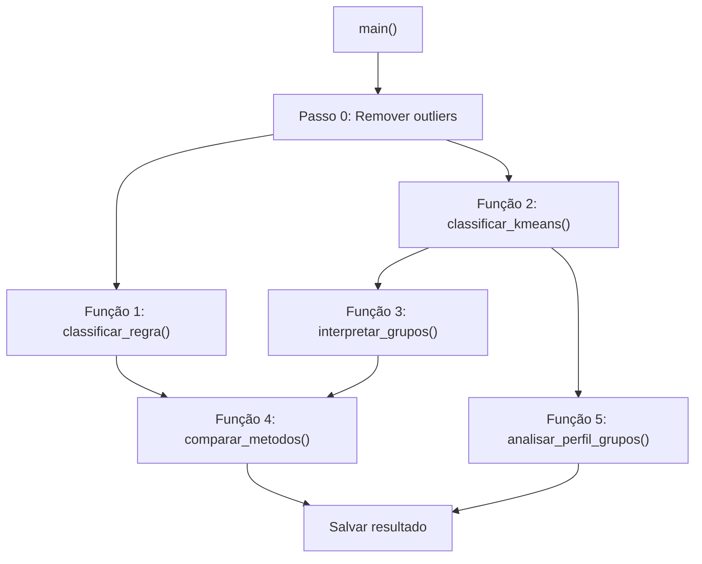

# Explicação do modelo_ia.py — Etapa 5: Modelagem

> Este documento explica detalhadamente o código do `modelo_ia.py`,
> linha por linha, conectando com a teoria do K-Means.

---

# 1. Visão geral

O arquivo `modelo_ia.py` aplica **duas abordagens** para classificar roteadores:

1. **Regra de negócio** (baseline, NÃO é ML) — `if razao > 0.5 → comercial`
2. **K-Means** (clustering, É ML) — agrupa por similaridade do perfil horário

Depois **compara** os dois métodos para ganhar confiança.

## Fluxo das funções



---

# 2. Carregamento dos dados

```python
df = pd.read_csv("data/processed/features_2026-04-01.csv", index_col="router_mac")
```

| Parte                    | O que faz                             |
| ------------------------ | ------------------------------------- |
| `pd.read_csv(...)`       | Lê o CSV e transforma em DataFrame    |
| `index_col="router_mac"` | Usa a coluna `router_mac` como índice |

**Por que `index_col`?** Assim o índice do DataFrame é o MAC do roteador.
Quando fizermos `join` depois, o pandas junta automaticamente pelo MAC.

---

# 3. Função 1: `classificar_regra(df)` — regra de negócio

## O código

```python
classificacao = df["razao_comercial"].apply(
    lambda r: "comercial" if r > 0.5 else "residencial"
)
```

## Explicação

| Parte                                       | O que faz                                       |
| ------------------------------------------- | ----------------------------------------------- |
| `df["razao_comercial"]`                     | Seleciona a coluna razao_comercial (Series)     |
| `.apply(lambda r: ...)`                     | Aplica uma função a cada valor                  |
| `lambda r:`                                 | Função anônima: `r` é cada valor da coluna      |
| `"comercial" if r > 0.5 else "residencial"` | Se razão > 0.5 → comercial, senão → residencial |

## Exemplo

```
razao_comercial:           classificacao:
0.72        →              "comercial"
0.31        →              "residencial"
0.55        →              "comercial"
0.48        →              "residencial"
```

**Conceito:** `apply` é como um loop, mas vetorizado. Para cada roteador,
aplica a regra. O resultado é uma Series com "comercial" ou "residencial".

**Isso NÃO é Machine Learning.** Você (humano) definiu a regra. O computador
só executa. É programação tradicional.

---

# 4. Função 2: `classificar_kmeans(df, k=2)` — o K-Means

Esta é a função mais importante! O K-Means é um algoritmo de clustering
que agrupa roteadores com perfis horários parecidos.

## Passo 1: Selecionar as colunas do perfil

```python
colunas_perfil = [f"h_{i}" for i in range(24)]
perfil = df[colunas_perfil]
```

| Parte                | O que faz                              |
| -------------------- | -------------------------------------- |
| `range(24)`          | Gera 0, 1, 2, ..., 23                  |
| `f"h_{i}"`           | Cria strings "h_0", "h_1", ..., "h_23" |
| `df[colunas_perfil]` | Seleciona só essas 24 colunas          |

**Por que só essas colunas?** O K-Means deve agrupar pelo **perfil horário**
(quando o tráfego acontece), não pelo volume total.

## Passo 2: Normalização L1

```python
soma_por_router = perfil.sum(axis=1)
perfil_normalizado = perfil.div(soma_por_router, axis=0)
```

| Parte                      | O que faz                                             |
| -------------------------- | ----------------------------------------------------- |
| `perfil.sum(axis=1)`       | Soma cada LINHA (axis=1 = horizontal) → tráfego total |
| `perfil.div(soma, axis=0)` | Divide cada linha pelo seu total → cada perfil soma 1 |

### Exemplo da normalização

```
Antes:                              Depois (L1):
         h_0    h_1    h_2    soma        h_0    h_1    h_2
Router A  100    200    300    600     0.17   0.33   0.50  ← soma 1
Router B  1000   2000   3000   6000    0.17   0.33   0.50  ← mesma forma!
```

**Por que isso é importante?** Sem isso, o K-Means agrupa por volume
(Router A e B em grupos diferentes). Com L1, agrupa por padrão
(mesmo grupo, porque têm a mesma "forma").

### Por que L1 e não StandardScaler?

O `StandardScaler` normaliza por **coluna** (cada hora). Mas roteadores
com muito tráfego têm valores altos em **todas** as horas. O K-Means
vê isso como "estão longe" e os agrupa separadamente — agrupa por
**volume**, não por **padrão**.

A normalização L1 divide cada perfil pela sua soma. Assim, cada
roteador vira uma distribuição que soma 1. Comparamos a **forma**
do tráfego, não o tamanho.

## Passo 3: Criar e treinar o K-Means

```python
kmeans = KMeans(n_clusters=k, random_state=42, n_init=10)
grupos = kmeans.fit_predict(perfil_normalizado)
```

### De onde vem o `KMeans`?

O `KMeans` é uma classe da biblioteca **scikit-learn** (`sklearn.cluster`).
É a implementação oficial do algoritmo K-Means em Python.

### O que cada parâmetro significa

| Parâmetro         | O que faz                               | Por que usar                           |
| ----------------- | --------------------------------------- | -------------------------------------- |
| `n_clusters=k`    | Número de grupos (K)                    | K=2 para comercial vs residencial      |
| `random_state=42` | Semente aleatória                       | Resultado reproduzível (sempre igual)  |
| `n_init=10`       | Roda 10 vezes com centroides diferentes | Fica com a melhor (evita mínimo local) |

### O que `fit_predict` faz?

O `fit_predict` **abstrai toda a lógica** do algoritmo K-Means.
Internamente, ele faz:

1. Coloca K centroides aleatórios no espaço de 24 dimensões
2. Calcula a distância euclidiana de cada roteador até cada centroide
3. Atribui cada roteador ao centroide mais próximo
4. Move os centroides para a média do seu grupo
5. Repete passos 2-4 até os centroides pararem de mover (convergir)
6. Retorna o grupo (0, 1, ...) de cada roteador

**Conceito:** Isso se chama **abstração**. Você usa o algoritmo sem
precisar implementar cada passo. É como dirigir um carro sem saber
como o motor funciona.

## Passo 4: Converter para Series

```python
grupos_series = pd.Series(grupos, index=df.index, name="grupo_kmeans")
```

| Parte                    | O que faz                                    |
| ------------------------ | -------------------------------------------- |
| `pd.Series(grupos, ...)` | Transforma o array numpy em Series pandas    |
| `index=df.index`         | Usa o mesmo índice do DataFrame (router_mac) |
| `name="grupo_kmeans"`    | Nome da Series                               |

**Por que converter?** O `fit_predict` retorna um array simples
(0, 1, 0, 1, ...). Transformamos em Series para manter a associação
com o router_mac.

## Passo 5: Contar e avaliar

```python
for g in range(k):
    print(f"[kmeans] Grupo {g}: {(grupos_series == g).sum()} roteadores")

silhouette = silhouette_score(perfil_normalizado, grupos)
```

| Parte                   | O que faz                                 |
| ----------------------- | ----------------------------------------- |
| `grupos_series == g`    | Retorna True/False (pertence ao grupo g?) |
| `.sum()`                | Conta quantos True (True = 1, False = 0)  |
| `silhouette_score(...)` | Calcula métrica de qualidade (-1 a 1)     |

---

# 5. Função 3: `interpretar_grupos(df, grupos)` — dar nomes aos grupos

## O problema

O K-Means retorna grupos 0 e 1, mas **não diz qual é comercial**!
Precisamos descobrir.

## O código

```python
df_com_grupos = df.copy()
df_com_grupos["grupo_kmeans"] = grupos
razao_por_grupo = df_com_grupos.groupby("grupo_kmeans")["razao_comercial"].mean()
```

| Parte                         | O que faz                                    |
| ----------------------------- | -------------------------------------------- |
| `df.copy()`                   | Cópia do DataFrame (não modifica o original) |
| `df["grupo_kmeans"] = grupos` | Adiciona coluna com o grupo de cada roteador |
| `groupby("grupo_kmeans")`     | Agrupa por grupo                             |
| `["razao_comercial"].mean()`  | Calcula a razão média de cada grupo          |

### Exemplo

```
grupo_kmeans  razao_comercial
0             0.23    ← baixa → residencial
1             0.46    ← alta → comercial
```

```python
grupo_comercial = razao_por_grupo.idxmax()
grupo_residencial = razao_por_grupo.idxmin()
```

| Parte      | O que faz                                          |
| ---------- | -------------------------------------------------- |
| `idxmax()` | Retorna o ÍNDICE (nome do grupo) com o maior valor |
| `idxmin()` | Retorna o ÍNDICE (nome do grupo) com o menor valor |

**Diferença entre `max` e `idxmax`:**

- `max()` → retorna o valor máximo (ex: 0.46)
- `idxmax()` → retorna QUEM tem o valor máximo (ex: grupo 1)

```python
mapeamento = {
    grupo_comercial: "comercial",
    grupo_residencial: "residencial"
}
classificacao_kmeans = grupos.map(mapeamento)
```

| Parte                    | O que faz                                      |
| ------------------------ | ---------------------------------------------- |
| `mapeamento`             | Dicionário: {1: "comercial", 0: "residencial"} |
| `grupos.map(mapeamento)` | Substitui 0 → "residencial", 1 → "comercial"   |

**Conceito:** `map` substitui valores usando um dicionário. É como uma
"tradução": 0 vira "residencial", 1 vira "comercial".

---

# 6. Função 4: `comparar_metodos(regra, kmeans)` — comparar os dois

## Criar DataFrame de comparação

```python
comparacao = pd.DataFrame({
    "regra": regra,
    "kmeans": kmeans
})
```

### Como funciona sem acessar o DataFrame original?

As Series `regra` e `kmeans` **já têm o índice** (router_mac) embutido.
O pandas alinha automaticamente pelo índice:

```
regra (Series):              kmeans (Series):
router_mac                   router_mac
AA:01    comercial           AA:01    comercial
BB:02    residencial         BB:02    comercial
CC:03    comercial           CC:03    comercial
```

O pandas junta pelo índice (router_mac):

```
          regra        kmeans
router_mac
AA:01     comercial    comercial    ← mesmo roteador, lado a lado
BB:02     residencial  comercial    ← mesmo roteador, lado a lado
CC:03     comercial    comercial    ← mesmo roteador, lado a lado
```

**Conceito:** O pandas alinha automaticamente pelo índice. Não precisa
acessar o DataFrame original — as Series já carregam a identificação.

## Calcular concordância

```python
concordam = (comparacao["regra"] == comparacao["kmeans"]).sum()
```

| Parte                                         | O que faz                            |
| --------------------------------------------- | ------------------------------------ |
| `comparacao["regra"] == comparacao["kmeans"]` | Compara linha por linha (True/False) |
| `.sum()`                                      | Conta quantos True (concordam)       |

## Matriz de confusão (crosstab)

```python
matriz = pd.crosstab(comparacao["regra"], comparacao["kmeans"], margins=True)
```

### O que é matriz de confusão?

É uma tabela que mostra **quantos roteadores** caem em cada combinação
de classificações.

### Exemplo com 5 roteadores

```
router_mac    regra        kmeans
AA:01        comercial    comercial    ← os dois dizem comercial
BB:02        residencial  comercial    ← regra diz residencial, kmeans diz comercial
CC:03        residencial  residencial  ← os dois dizem residencial
DD:04        comercial    comercial    ← os dois dizem comercial
EE:05        residencial  residencial  ← os dois dizem residencial
```

O `crosstab` **conta** cada combinação:

```
kmeans       comercial  residencial  All
regra
comercial          2          0       2    ← 2 que a regra diz comercial
residencial        1          2       3    ← 3 que a regra diz residencial
All                3          2       5    ← totais
```

### Como ler a matriz

```
                    K-Means diz:
                   comercial  residencial
Regra diz:
comercial              2          0        ← 2 que a regra diz comercial
                                          (2 concordam, 0 discordam)
residencial           1          2        ← 3 que a regra diz residencial
                                          (2 concordam, 1 discorda)
```

**Conceito:** A diagonal principal (2, 2) são as **concordâncias**.
Fora da diagonal (0, 1) são as **discordâncias**. Quanto mais na
diagonal, melhor!

---

# 7. Função 5: `analisar_perfil_grupos(df, grupos)` — entender os grupos

## O código

```python
perfil_medio = df_com_grupos.groupby("grupo")[colunas_perfil].mean()
```

| Parte              | O que faz                                    |
| ------------------ | -------------------------------------------- |
| `groupby("grupo")` | Agrupa por grupo                             |
| `[colunas_perfil]` | Seleciona as 24 colunas h_0 a h_23           |
| `.mean()`          | Calcula a média de cada hora para cada grupo |

**Conceito:** Para cada grupo, calcula o "roteador médio" — o perfil
horário típico daquele grupo.

```python
top5 = perfil_medio.loc[g].nlargest(5)
```

| Parte                 | O que faz                                             |
| --------------------- | ----------------------------------------------------- |
| `perfil_medio.loc[g]` | Seleciona o grupo g                                   |
| `.nlargest(5)`        | Retorna as 5 maiores valores (horas com mais tráfego) |

---

# 8. Função `main()` — a orquestradora

## `global df`

```python
global df
```

**Por que `global`?** Sem o `global`, o Python cria uma variável local
quando fazemos `df = df[...]`. O `global` diz: "quando eu falar de df,
é o de fora".

### Quando usar `global`?

| Situação                             | Precisa de `global`? |
| ------------------------------------ | -------------------- |
| Só **ler** a variável global         | ❌ Não               |
| **Atribuir** valor à variável global | ✅ Sim               |
| Criar variável nova local            | ❌ Não               |

## Passo 0: Remover outliers

```python
trafego_total = df[colunas_perfil].sum(axis=1)
mediana = trafego_total.median()
mascara_sem_outlier = trafego_total < (mediana * 100)
df = df[mascara_sem_outlier]
```

| Parte               | O que faz                                         |
| ------------------- | ------------------------------------------------- |
| `sum(axis=1)`       | Soma cada linha (tráfego total por roteador)      |
| `median()`          | Calcula a mediana (robusta a outliers)            |
| `< (mediana * 100)` | True para roteadores com tráfego < 100x a mediana |
| `df[mascara]`       | Filtra só os True (sem outliers)                  |

### Por que remover outliers se há normalização L1?

A normalização L1 resolve o problema de **volume**, mas não resolve
o problema de **padrão**.

#### O que a L1 resolve

```
Router A: [100, 200, 300]  → L1 → [0.17, 0.33, 0.50]  ← volume removido
Router B: [1M, 2M, 3M]     → L1 → [0.17, 0.33, 0.50]  ← mesmo padrão!
```

A L1 faz os dois terem o mesmo perfil. **Volume não é mais problema.**

#### O que a L1 NÃO resolve

```
Router normal:     [10, 20, 30, 40, 50, 60, 70, 80]  → L1 → [0.03, 0.06, ...]
Router outlier:    [300B, 300B, 300B, 300B, ...]      → L1 → [0.04, 0.04, ...]
```

O outlier tem um **padrão diferente** (plano, sem pico). Mesmo após L1,
o padrão dele é tão diferente de todos os outros que o K-Means coloca
um centroide só para ele!

#### Resumo

| Problema                                  | L1 resolve? | Outra solução   |
| ----------------------------------------- | ----------- | --------------- |
| Volume diferente (muito vs pouco tráfego) | ✅ Sim      | —               |
| Padrão diferente (plano vs com pico)      | ❌ Não      | Remover outlier |

**Conceito:** A L1 normaliza o **tamanho**, mas o outlier pode ter um
**formato** tão diferente que ainda distorce o clustering. É como
normalizar a altura de todas as pessoas, mas alguém com 3 braços ainda
seria um outlier — a normalização não resolve diferenças de **forma**.

## Passo final: Salvar

```python
resultado = df.copy()
resultado["classificacao_regra"] = classificacao_regra
resultado["classificacao_kmeans"] = classificacao_kmeans
resultado["concorda"] = resultado["classificacao_regra"] == resultado["classificacao_kmeans"]
resultado.to_csv("data/processed/classificacao_ia_2026-04-01.csv")
```

| Parte                          | O que faz                                    |
| ------------------------------ | -------------------------------------------- |
| `df.copy()`                    | Cópia do DataFrame (não modifica o original) |
| `resultado["coluna"] = series` | Adiciona colunas novas                       |
| `==`                           | Compara linha por linha (True/False)         |
| `to_csv(...)`                  | Salva em arquivo CSV                         |

### Por que `df.copy()` em vez de modificar `df` diretamente?

Se modificarmos `df` diretamente, as funções que já rodaram (e usaram `df`)
podem ser afetadas. `copy()` cria uma cópia independente — modificar uma
não afeta a outra.

---

# 9. Resumo dos conceitos do código

| Conceito           | Onde aparece              | O que faz                                     |
| ------------------ | ------------------------- | --------------------------------------------- |
| `apply(lambda)`    | classificar_regra         | Aplica função a cada valor                    |
| `sum(axis=1)`      | normalização L1, outliers | Soma por linha                                |
| `div(axis=0)`      | normalização L1           | Divide por linha                              |
| `fit_predict`      | K-Means                   | Treina e retorna grupos (abstrai o algoritmo) |
| `groupby().mean()` | interpretar, analisar     | Agrupa e calcula média                        |
| `idxmax/idxmin`    | interpretar               | Acha quem tem maior/menor valor               |
| `map(dicionário)`  | interpretar               | Substitui valores                             |
| `crosstab`         | comparar                  | Tabela de contingência (matriz de confusão)   |
| `nlargest`         | analisar                  | Top N maiores valores                         |
| `global`           | main                      | Modifica variável externa                     |
| `copy()`           | várias                    | Cria cópia independente do DataFrame          |

---

# 10. Parâmetros do K-Means (scikit-learn)

| Parâmetro      | O que faz                            | Valor usado | Por que                  |
| -------------- | ------------------------------------ | ----------- | ------------------------ |
| `n_clusters`   | Número de grupos (K)                 | 2           | Comercial vs residencial |
| `random_state` | Semente aleatória                    | 42          | Resultado reproduzível   |
| `n_init`       | Tentativas com centroides diferentes | 10          | Fica com a melhor        |

### Por que `random_state=42`?

Sem isso, cada execução pode dar resultado diferente (centroides
aleatórios diferentes). Com `random_state=42`, o resultado é sempre
o mesmo — importante para reproduzir resultados.

### Por que `n_init=10`?

O K-Means começa com centroides aleatórios. Se começar mal, pode
ficar preso num resultado ruim (mínimo local). Rodar 10 vezes com
centroides diferentes e ficar com a melhor reduz esse risco.

---

# 11. Silhouette Score

## O que mede?

Para cada roteador, responde:

1. **Quão parecido** ele é com os do seu grupo? (coesão)
2. **Quão diferente** ele é dos outros grupos? (separação)

## Fórmula

```
a(X) = distância média de X até os roteadores do MESMO grupo (coesão)
b(X) = distância média de X até os roteadores do grupo MAIS PRÓXIMO (separação)

Silhouette(X) = (b(X) - a(X)) / max(a(X), b(X))
```

## Interpretação

| Score        | Significado               |
| ------------ | ------------------------- |
| Próximo de 1 | Grupos bem separados ✅   |
| Próximo de 0 | Grupos sobrepostos ⚠️     |
| Negativo     | Pontos no grupo errado ❌ |

## No projeto

| Configuração        | Silhouette | Interpretação                         |
| ------------------- | ---------- | ------------------------------------- |
| K=2, StandardScaler | 0.99       | ⚠️ Enganoso! 1 grupo tinha 1 roteador |
| K=2, L1             | 0.099      | Grupos sobrepostos, mas reais         |

**Conceito:** Silhouette alto nem sempre é bom! Precisa olhar também
o tamanho dos grupos e se fazem sentido.
