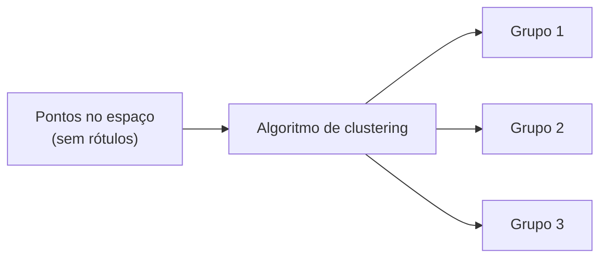
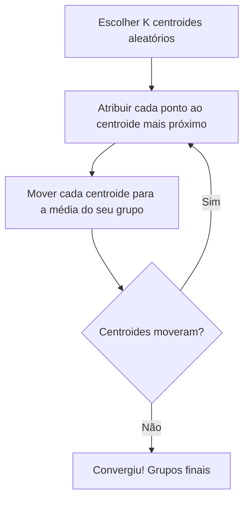
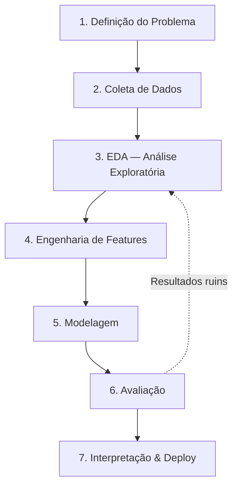
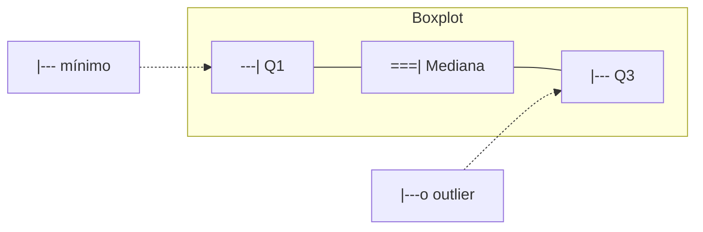
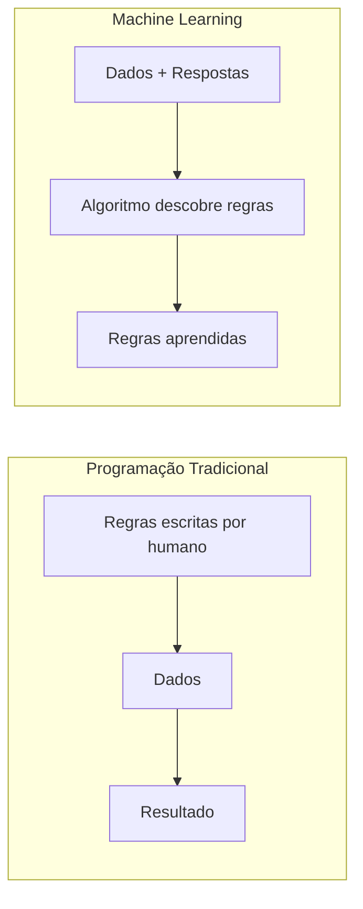
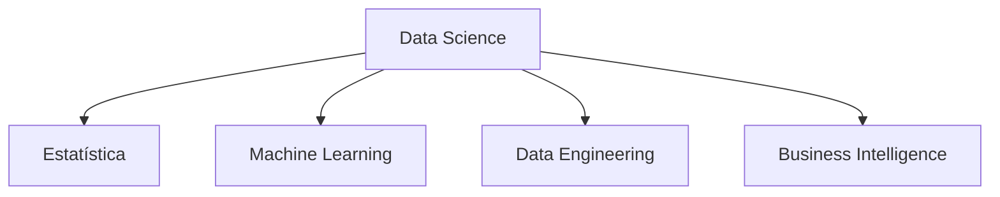
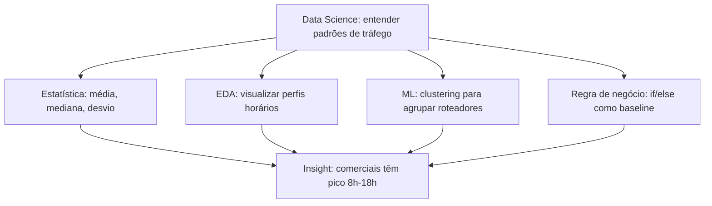

# Material de Estudo — Data Science, Estatística e Machine Learning

> Este documento reúne os conceitos teóricos do projeto **Modelo Residencial Comercial**.
> Use como material de referência durante o desenvolvimento.

---

# 1. Aprendizado Não Supervisionado (Clustering)

Existem três grandes categorias de Machine Learning:

## 1.1 Supervisionado

Você tem **rótulos** (respostas certas) nos dados de treino. O modelo aprende a mapear entrada → rótulo.

> Exemplo: você tem 1000 fotos **rotuladas** como "gato" ou "cachorro". O modelo aprende a distinguir.

## 1.2 Não supervisionado

Você **não tem rótulos**. O modelo encontra **estrutura/padrões** nos dados por conta própria.

> Exemplo: você tem dados de clientes de um e-commerce sem nenhuma categoria. O modelo agrupa clientes parecidos entre si. Você **descobre** os grupos depois.

## 1.3 Reforço

O modelo aprende por **tentativa e erro** recebendo recompensas/punições.

---

## Clustering (agrupamento)

Clustering é uma técnica de aprendizado não supervisionado. A ideia é simples: dado um conjunto de objetos, **agrupar os parecidos** e **separar os diferentes**.



**No projeto:**
- Você **não sabe** de antemão quais roteadores são residenciais ou comerciais (não tem rótulos)
- Você tem as **features** de cada roteador (tráfego por hora, estatísticas, etc.)
- O algoritmo agrupa roteadores com **perfis parecidos**
- **Depois** você interpreta: "o grupo que tem pico de 8h-18h é o comercial"

### K-Means (o algoritmo mais comum)

Funciona assim:

1. Você escolhe **K** (número de grupos, ex: 2)
2. O algoritmo coloca **K pontos aleatórios** (centroides) no espaço
3. Cada roteador é atribuído ao **centroide mais próximo**
4. Os centroides se **movem** para o centro de seus grupos
5. Repete passos 3-4 até convergir (centroides param de mover)



**"Mais próximo"** = distância euclidiana (a distância "normal" entre dois pontos). Se cada roteador tem 24 features (perfil horário), cada roteador é um ponto num espaço de 24 dimensões, e o K-Means mede a distância entre eles.

> ⚠️ **Importante:** como features têm escalas diferentes (ex: bytes podem ser milhões, razão é 0-1), é preciso **normalizar** antes do K-Means. O `StandardScaler` coloca tudo na mesma escala (média=0, desvio=1).

---

# 2. Ciclo de Vida de um Projeto de Data Science — Detalhado



## Etapa 1: Definição do Problema

**O que é:** Entender **exatamente** o que você quer resolver, em linguagem de negócio.

**Perguntas que você deve se fazer:**
- Qual pergunta estou respondendo? → *"Este roteador é residencial ou comercial?"*
- Como vou usar o resultado? → *"Para segmentar clientes, planejar capacidade da rede, etc."*
- Que dados preciso? → *"Tráfego de rede ao longo do tempo"*
- Como vou saber se funcionou? → *"Validar com a localização do roteador"*

> **Erro comum de iniciante:** pular esta etapa e ir direto pro código. Sem clareza do problema, você analisa a coisa errada.

## Etapa 2: Coleta de Dados

**O que é:** Obter os dados de onde estiverem (banco de dados, APIs, arquivos, etc.).

**No projeto:** dados no QuestDB nas tabelas `routers` e `device_metrics`.

**Conceitos importantes:**
- **Schema:** a estrutura das tabelas (quais colunas, quais tipos). Você precisa saber quais colunas existem antes de consultar.
- **Amostragem:** se há milhões de linhas, pode ser inviável carregar tudo. Você pode filtrar por data ou amostrar aleatoriamente.
- **Cache:** salvar os dados extraídos em arquivo local (CSV, Parquet) para não re-consultar o banco a cada iteração. Durante o desenvolvimento você vai rodar o código dezenas de vezes — consultar o banco toda vez é lento.

## Etapa 3: EDA — Análise Exploratória de Dados

**O que é:** "Conhecer" os dados antes de modelar. É a fase **mais importante**.

**O que fazer no EDA:**

1. **Visão geral:** quantas linhas? quantas colunas? quais os tipos?
2. **Dados faltantes:** quantos valores nulos existem? Em quais colunas? Dados faltantes podem distorcer análises.
3. **Estatísticas descritivas:** média, mediana, mínimo, máximo, desvio padrão de cada coluna numérica.
4. **Distribuições:** histogramas para ver como os dados se distribuem (simétricos? enviesados? tem outliers?).
5. **Correlações:** quais variáveis se movem juntas?
6. **Visualizações temporais:** no caso do projeto, tráfego por hora do dia — para ver se há padrão.

> **Por que antes de modelar?** Se você modela sem conhecer os dados, pode usar features inúteis, ignorar outliers que distorcem tudo, ou descobrir tarde que 40% dos dados estão faltando.

## Etapa 4: Engenharia de Features

**O que é:** Transformar dados brutos em **informações úteis** para o modelo.

**Feature** = uma coluna/variável que descreve cada objeto. No projeto, cada roteador será descrito por várias features.

**Por que é necessário:** os dados brutos (timestamp + bytes acumulados) não são diretamente úteis. Precisamos transformá-los.

**Exemplos no projeto:**
- Dado bruto: `bytes_up = 1500000` (acumulado) → Feature: `delta_bytes_up = 50000` (tráfego na última hora)
- Dado bruto: `timestamp = 2025-01-15 14:30` → Feature: `hora = 14`, `eh_comercial = True`
- Dados brutos de um dia inteiro → Feature: `media_comercial = 480000` (média do tráfego das 8h-18h)
- 24 horas de dados → Feature: perfil horário `[h_0, h_1, ..., h_23]`

**Conceito-chave:** cada roteador vira **uma linha** com várias features. É essa tabela que alimenta o modelo.

## Etapa 5: Modelagem

**O que é:** Aplicar o algoritmo que resolve o problema.

**No projeto:** duas abordagens:
- **Regra de negócio:** `se razao_comercial > 0.5 → comercial`
- **Clustering (K-Means):** agrupa roteadores por similaridade do perfil horário

**Decisões que você toma aqui:**
- Qual algoritmo?
- Quais features usar?
- Quais parâmetros? (ex: K=2 ou K=3 no K-Means)

## Etapa 6: Avaliação

**O que é:** Verificar se o resultado faz sentido.

**Como avaliar clustering (sem rótulos):**
- **Inspeção visual:** plotar os perfis horários de cada grupo — faz sentido?
- **Métricas internas:** Silhouette Score (mede quão bem separados os grupos estão)
- **Validação externa:** cruzar com a localização (tabela `routers`) — roteadores "comerciais" estão em zonas comerciais?
- **Comparação de métodos:** se a regra e o clustering concordam, você ganha confiança

> **Erro comum:** confiar no resultado só porque o algoritmo rodou. Sempre valide!

## Etapa 7: Interpretação & Deploy

**O que é:** Traduzir o resultado em decisões de negócio e colocar em produção.

- **Interpretação:** "70% dos roteadores são residenciais; os comerciais concentram tráfego 9h-17h em dias úteis"
- **Deploy:** automatizar para rodar periodicamente (ex: todo mês, classificar novos roteadores)

---

# 3. Estatísticas — O que são e como calcular

Vamos usar um exemplo simples: o tráfego (em MB) de um roteador em 5 horas:

$$\text{dados} = [10, 20, 30, 40, 100]$$

## 3.1 Média (Mean)

**O que é:** a soma de todos os valores dividida pela quantidade. O "valor médio" no sentido comum.

**Como calcular:**

$$\text{média} = \frac{10 + 20 + 30 + 40 + 100}{5} = \frac{200}{5} = 40$$

**Fórmula geral:**

$$\bar{x} = \frac{1}{n}\sum_{i=1}^{n} x_i$$

**⚠️ Problema:** a média é **sensível a outliers**. O valor 100 puxou a média para 40, mas a "maioria" dos valores está entre 10-40. A média pode enganar.

**Em pandas:** `df["coluna"].mean()`

---

## 3.2 Mediana

**O que é:** o valor do "meio" quando os dados estão ordenados. Metade dos valores está acima, metade abaixo.

**Como calcular:**
1. Ordena os dados: `[10, 20, 30, 40, 100]`
2. Pega o do meio (posição 3 de 5): **30**

**Se houver número par de valores** (ex: `[10, 20, 30, 40]`):
- Pega os dois do meio: 20 e 30
- Mediana = média deles = (20+30)/2 = **25**

**Por que usar:** a mediana **ignora outliers**. No exemplo, mediana=30 representa melhor o "típico" que a média=40.

**Em pandas:** `df["coluna"].median()`

---

## 3.3 Moda

**O que é:** o valor que **mais aparece** (mais frequente).

**Exemplo:** `[10, 20, 20, 30, 40]` → moda = **20** (aparece 2 vezes)

**Quando usar:** para dados categóricos ou discretos. Pouco útil para tráfego de rede (valores contínuos quase nunca se repetem).

**Em pandas:** `df["coluna"].mode()`

---

## 3.4 Mínimo e Máximo

**O que é:** o menor e o maior valor.

$$\min = 10, \quad \max = 100$$

**Em pandas:** `df["coluna"].min()`, `df["coluna"].max()`

---

## 3.5 Quartis (Q1, Q2, Q3)

**O que é:** dividem os dados ordenados em 4 partes iguais (cada parte tem 25% dos dados).

- **Q1 (primeiro quartil):** 25% dos dados estão abaixo dele
- **Q2 (segundo quartil):** 50% — **é a mediana!**
- **Q3 (terceiro quartil):** 75% dos dados estão abaixo dele

**Como calcular** (para `[10, 20, 30, 40, 100]`):
- Q1 = valor na posição 25% → entre 10 e 20 → **15** (interpolação)
- Q2 = mediana = **30**
- Q3 = valor na posição 75% → entre 40 e 100 → **70**

**Por que usar:** quartis descrevem a **distribuição** sem serem afetados por outliers. A diferença Q3-Q1 chama-se **IQR (Intervalo Interquartil)** e mede a dispersão "central" ignorando extremos.

**Em pandas:** `df["coluna"].quantile(0.25)`, `df["coluna"].quantile(0.75)`

---

## 3.6 Variância

**O que é:** mede quão "espalhados" os dados estão em relação à média.

**Como calcular:**
1. Calcula a média: 40
2. Para cada valor, calcula a diferença da média e eleva ao quadrado:
   - $(10-40)^2 = 900$
   - $(20-40)^2 = 400$
   - $(30-40)^2 = 100$
   - $(40-40)^2 = 0$
   - $(100-40)^2 = 3600$
3. Soma tudo: $900+400+100+0+3600 = 5000$
4. Divide por $n-1 = 4$ (para amostra): $5000/4 = 1250$

$$s^2 = \frac{1}{n-1}\sum_{i=1}^{n}(x_i - \bar{x})^2$$

> **Por que $n-1$ e não $n$?** Quando você tem uma **amostra** (não a população inteira), usar $n-1$ (correção de Bessel) dá uma estimativa **não viesada** da variância populacional. Em pandas/numpy, o padrão é $n-1$.

> **Por que elevar ao quadrado?** Para que diferenças positivas e negativas não se anulem, e para penalizar mais os valores muito distantes.

**Em pandas:** `df["coluna"].var()`

---

## 3.7 Desvio Padrão (Standard Deviation)

**O que é:** a **raiz quadrada da variância**. É a mesma ideia, mas na mesma unidade dos dados.

$$s = \sqrt{1250} \approx 35.4$$

**Por que não usar só a variância?** A variância está em "unidades ao quadrado" (ex: MB²), o que não faz sentido prático. O desvio padrão volta para a unidade original (MB).

**Interpretação prática:**
- Desvio **baixo** → dados concentrados perto da média → tráfego **consistente** (típico de comercial)
- Desvio **alto** → dados espalhados → tráfego **variável** (típico de residencial com pico noturno e vale de madrugada)

**Em pandas:** `df["coluna"].std()`

---

## 3.8 Coeficiente de Variação (CV)

**O que é:** o desvio padrão **dividido pela média**. É uma medida de variabilidade **relativa** (sem unidade).

$$CV = \frac{s}{\bar{x}} = \frac{35.4}{40} = 0.885$$

**Por que usar:** o desvio padrão de 35.4 MB é "muito" ou "pouco"? Depende da média! Se a média é 40, é muito (CV=0.885). Se a média é 1000, é pouco (CV=0.035). O CV permite comparar variabilidade entre roteadores com tráfegos de magnitudes diferentes.

**Em pandas:** `df["coluna"].std() / df["coluna"].mean()`

---

## 3.9 Amplitude (Range)

**O que é:** máximo - mínimo.

$$\text{amplitude} = 100 - 10 = 90$$

**Problema:** só usa 2 valores, ignora todo o resto. Muito sensível a outliers.

**Em pandas:** `df["coluna"].max() - df["coluna"].min()`

---

## 3.10 Resumo: qual usar quando?

| Estatística | Resiste a outliers? | Mede o quê? |
|---|---|---|
| **Média** | ❌ Não | Tendência central |
| **Mediana** | ✅ Sim | Tendência central (robusta) |
| **Desvio padrão** | ❌ Não | Dispersão |
| **IQR (Q3-Q1)** | ✅ Sim | Dispersão (robusta) |
| **Coef. variação** | ❌ Não | Dispersão relativa (comparar escalas) |
| **Amplitude** | ❌ Não | Dispersão (simples mas frágil) |

---

## 3.11 Boxplot — visualizando tudo junto

O boxplot mostra mediana, quartis e outliers em um só gráfico:



- A "caixa" vai de Q1 a Q3 (contém 50% dos dados)
- A linha dentro da caixa é a mediana
- Os "bigodes" se estendem até 1.5×IQR
- Pontos além dos bigodes = **outliers**

---

# 4. Machine Learning vs "Só um if/else"

## 4.1 A confusão: "Supervisionado não é só um if/else?"

Depende do caso! Vamos separar duas situações:

### Situação A: Regra de negócio (NÃO é ML)

No projeto, se você faz:

```python
if razao_comercial > 0.5:
    return "comercial"
else:
    return "residencial"
```

**Isso NÃO é Machine Learning.** É uma **regra determinística** — você, humano, decidiu o critério. O computador só executa. Isso é programação tradicional.

### Situação B: Aprendizado supervisionado (É ML)

Imagine que você **não sabe** qual é o limiar. Você tem 200 roteadores e **rotulou manualmente** 50 deles (olhou o endereço, verificou se é comércio ou casa). Agora você dá esses 50 ao algoritmo:

```
Entrada: [features do roteador]  →  Rótulo: "comercial"
Entrada: [features do roteador]  →  Rótulo: "residencial"
...50 exemplos...
```

O algoritmo **encontra sozinho** a regra que melhor separa os dois grupos. Talvez ele descubra que não é só `razao_comercial > 0.5` — talvez seja uma **combinação** de razão + desvio padrão + hora de pico. Talvez o limiar ótimo seja 0.43, não 0.5. Talvez a fronteira não seja uma linha reta.

**A diferença fundamental:**

| | Programação tradicional | Machine Learning |
|---|---|---|
| **Quem escreve a regra?** | Você, humano | O algoritmo descobre |
| **O que você dá?** | As regras + os dados | Os dados + as respostas |
| **Exemplo** | `if tráfego > X: comercial` | "Aqui estão 50 exemplos rotulados, descubra o padrão" |



> **Resumo:** no ML, você **não programa a regra**. Você dá exemplos e o algoritmo **aprende** a regra. Se você escreve o `if` você mesmo, é programação tradicional, não ML.

---

## 4.2 Mas então, o que É Machine Learning?

**Definição formal (Tom Mitchell, 1997):**

> "Um programa de computador aprende com experiência E em relação a uma tarefa T e medida de desempenho P, se seu desempenho em T, medido por P, melhora com a experiência E."

**Traduzindo para o projeto:**
- **T (tarefa):** classificar roteador como comercial ou residencial
- **E (experiência):** os dados históricos de tráfego de milhares de roteadores
- **P (desempenho):** % de classificações corretas

Se o programa **melhora** conforme vê mais dados, é ML. Se o desempenho não muda com mais dados (porque a regra é fixa), não é.

---

## 4.3 Os 3 tipos de ML (com exemplos do projeto)

### 1. Supervisionado

Você tem **rótulos** (respostas) em parte dos dados.

> No projeto: você rotula manualmente 50 roteadores (olhando o endereço no Google Maps). Treina um modelo. Ele classifica os outros 950 automaticamente.

**Subtipos:**
- **Classificação:** rótulos categóricos → "comercial" vs "residencial"
- **Regressão:** rótulos numéricos → prever **quantos** bytes de tráfego um roteador terá amanhã

### 2. Não supervisionado

Você **não tem rótulos**. O algoritmo encontra estrutura.

> No projeto: você não sabe qual roteador é o quê. O K-Means agrupa por similaridade do perfil horário. Depois você interpreta os grupos.

**Técnicas:**
- **Clustering:** agrupar parecidos (K-Means)
- **Redução de dimensionalidade:** simplificar muitas features em poucas (PCA)
- **Detecção de anomalias:** encontrar outliers (roteadores com comportamento estranho)

### 3. Aprendizado por reforço

O agente age e recebe **recompensas/punições**.

> Não se aplica ao projeto. Exemplo clássico: um robô aprendendo a andar — cai (punição) ou anda (recompensa).

---

## 4.4 Por que o projeto envolve ML?

O projeto tem **duas partes**:

### Parte 1: Regra de negócio (NÃO é ML)
```python
if razao_comercial > 0.5:
    classe = "comercial"
```
Isso é programação tradicional. Você definiu a regra.

### Parte 2: Clustering (É ML — não supervisionado)
```python
kmeans = KMeans(n_clusters=2)
kmeans.fit(perfil_horario)  # o algoritmo descobre os grupos
```
Aqui você **não** disse qual roteador é o quê. Você deu os perfis e o algoritmo **encontrou** os grupos. Isso é ML.

> **A beleza de usar ambos:** a regra serve de "baseline" (referência). Se o clustering concordar com a regra, você ganha confiança. Se discordar, você investiga os casos especiais.

---

# 5. Data Science vs Machine Learning — qual a relação?

São coisas **diferentes mas que se sobrepõem**:



| | Data Science | Machine Learning |
|---|---|---|
| **Foco** | Extrair **insights** dos dados | Construir **modelos preditivos** |
| **Pergunta típica** | "Quais padrões existem nos roteadores?" | "Este roteador é comercial ou residencial?" |
| **Ferramentas** | SQL, pandas, visualização, estatística | K-Means, regressão, redes neurais |
| **Resultado** | Relatório, gráfico, decisão | Modelo treinado, API, automação |
| **Precisa de ML?** | Às vezes | — |
| **Precisa de DS?** | — | Sim, sempre |

**Data Science é o guarda-chuva.** É o processo completo: do problema ao insight. ML é uma **ferramenta dentro** desse processo — usada quando você precisa de **predição automática** ou **descoberta de padrões** que humanos não enxergam.

### No projeto:



Você está fazendo **Data Science** (o processo completo) e usa **ML** (clustering) como uma das ferramentas. A regra if/else é apenas um **baseline** para comparação — não é ML, mas é útil.

---

## 5.1 Quando usar ML vs programação tradicional?

| Use **programação tradicional** se... | Use **ML** se... |
|---|---|
| A regra é **simples e conhecida** | A regra é **complexa ou desconhecida** |
| Você consegue escrever os ifs | Há interações entre variáveis que você não enxerga |
| O problema não muda com o tempo | O padrão muda e o modelo precisa se adaptar |
| Você precisa de **explicabilidade total** | Você aceita uma "caixa preta" que funciona |

**No projeto:** a regra `razao_comercial > 0.5` é simples e funciona. Mas e se existirem roteadores de **uso misto** (comércio embaixo, residência em cima)? A regra simples não captura isso. O clustering com K=3 ou K=4 pode descobrir um **terceiro grupo** que você nem imaginava. **Isso** é o valor do ML.