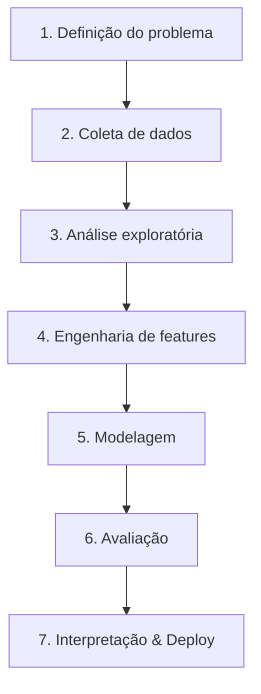

# Relatório Final — Modelo de Classificação Residencial/Comercial

> **Etapa 7: Interpretação & Deploy**
>
> Este relatório traduz os resultados técnicos do modelo em
> decisões e insights de negócio.

---

# 1. Resumo Executivo

## O que foi feito

Desenvolvemos um modelo de classificação que identifica se um roteador de internet está instalado em um endereço **residencial** ou **comercial**, baseado no padrão de tráfego de dados ao longo do tempo.

## Principais resultados

| Métrica                       | Valor         |
| ----------------------------- | ------------- |
| Roteadores analisados         | 3.932         |
| Roteadores comerciais         | 422 (10.7%)   |
| Roteadores residenciais       | 3.510 (89.3%) |
| Roteadores com padrão anômalo | 40 (1.0%)     |
| Concordância regra vs K-Means | 90.8%         |
| Silhouette Score              | 0.3935        |

## Como o modelo classifica

O modelo usa **duas abordagens** em paralelo:

1. **Regra de negócio**: se >50% do tráfego ocorre das 8h às 18h → comercial
2. **K-Means (Machine Learning)**: agrupa roteadores por similaridade do perfil horário

Quando os dois métodos concordam (90.8% dos casos), temos **alta confiança** na classificação.

---

# 2. Metodologia

## Fluxo completo do projeto



## Dados utilizados

- **Fonte**: QuestDB (banco de dados de séries temporais)
- **Período**: 1 mês (01/04/2026 a 08/05/2026)
- **Volume**: ~15,8 milhões de linhas por dia
- **Roteadores**: 6.089 únicos (após deduplicação)

## Features criadas

Para cada roteador, calculamos:

| Feature                    | Descrição                                          |
| -------------------------- | -------------------------------------------------- |
| `uteis_h_0` a `uteis_h_23` | Tráfego por hora em dias úteis                     |
| `fds_h_0` a `fds_h_23`     | Tráfego por hora em fins de semana                 |
| `razao_comercial`          | Proporção do tráfego no horário comercial (8h-18h) |
| `hora_pico`                | Hora de maior tráfego                              |

---

# 3. Insights Principais

## Insight 1: O padrão comercial vs residencial

| Característica             | Comercial                    | Residencial                 |
| -------------------------- | ---------------------------- | --------------------------- |
| **Pico em dias úteis**     | 18h (fim do expediente)      | 23h (Netflix/madrugada)     |
| **Pico em fins de semana** | 15h (mas 4x menor que úteis) | 23h (ainda maior que úteis) |
| **Comportamento em fds**   | Tráfego **cai** 75%          | Tráfego **sobe** 13%        |
| **Volume total**           | Menor (sistemas + trabalho)  | Maior (muitos dispositivos) |

> **Conclusão**: O sinal mais forte é a **diferença entre úteis e fds**. Comercial fecha em fds (tráfego cai). Residencial tem mais gente em casa em fds (tráfego sobe).

## Insight 2: O tráfego mede consumo, não trabalho

O tráfego de internet é **maior quando as pessoas NÃO estão trabalhando**:

- **Trabalhar** (digitar, email, planilhas) → pouco tráfego
- **Streaming** (Netflix, YouTube) → muito tráfego
- **Redes sociais** (Instagram, TikTok) → tráfego médio

> **Conclusão**: O modelo detecta "onde as pessoas consomem internet para lazer", não "onde trabalham". Mesmo assim, consegue distinguir residencial de comercial porque o padrão de lazer é diferente.

## Insight 3: Comercial não é só escritório

Roteadores classificados como comercial têm tráfego de madrugada (0h-3h), que parece estranho para escritórios. Mas faz sentido para:

- **Padarias** (abrem às 4h)
- **Farmácias 24h**
- **Postos de gasolina**
- **Bares/restaurantes** (fecham tarde)
- **Sistemas de segurança** (câmeras, alarmes)
- **Backups automáticos** (rodam de madrugada)

> **Conclusão**: "Comercial" inclui qualquer estabelecimento comercial, não apenas escritórios.

## Insight 4: Distribuição por cidade

| Cidade             | % Comercial | Perfil                    |
| ------------------ | ----------- | ------------------------- |
| Rio das Ostras     | 16.7%       | Cidade em crescimento     |
| Araruama           | 16.2%       | Cidade em desenvolvimento |
| Armação dos Búzios | 12.3%       | Cidade turística          |
| Nova Friburgo      | 10.0%       | Cidade grande             |
| Teresópolis        | 9.4%        | Cidade serrana            |
| Arraial do Cabo    | 8.5%        | Cidade de pesca/turismo   |
| Cabo Frio          | 5.8%        | Cidade turística          |
| Cordeiro           | 0.0%        | Cidade pequena/rural      |
| Quissamã           | 0.0%        | Cidade pequena            |

> **Conclusão**: Cidades maiores e turísticas têm mais comércio. Cidades pequenas e rurais são quase 100% residenciais.

---

# 4. Limitações

## Limitação 1: 66% dos roteadores sem localização

A tabela `routers` tem 66% dos roteadores sem endereço/cidade preenchido. A validação foi feita com os 34% que têm localização.

**Impacto**: A validação é uma amostra, não o universo completo.

## Limitação 2: O modelo mede lazer, não trabalho

Como o tráfego mede consumo de internet, escritórios onde as pessoas só trabalham (sem YouTube/Netflix) podem ser classificados como residencial (pouco tráfego durante o dia).

**Impacto**: Alguns comerciais podem ser classificados errado.

## Limitação 3: Feriados não tratados (ainda)

Feriados foram implementados no código mas os dados já processados não foram re-processados. Feriados como Tiradentes (21/04) e Dia do Trabalho (01/05) foram tratados como dias úteis.

**Impacto**: Alguns dias de feriado podem ter sido classificados errado.

## Limitação 4: Apenas 1 mês de dados

O modelo foi treinado com 1 mês. Padrões sazonais (férias escolares, Copa do Mundo) não foram capturados.

**Impacto**: O modelo pode não generalizar para outros meses.

---

# 5. Recomendações

## Recomendação 1: Usar a classificação com confiança

Para os 90.8% dos roteadores onde regra e K-Means concordam, a classificação é confiável. Para os 9.2% que discordam, investigar caso a caso.

## Recomendação 2: Re-processar com feriados

Apagar as features dos dias de feriado (21/04, 01/05) e re-processar com a nova lógica de feriados. Isso deve melhorar a acurácia.

## Recomendação 3: Ampliar para mais meses

Processar os 4 meses completos de dados para capturar sazonalidade (férias, Copa do Mundo).

## Recomendação 4: Investigar os 40 roteadores anômalos

Os 40 roteadores com padrão plano (sem pico) podem ser:

- Erros de coleta
- Roteadores mal configurados
- Roteadores novos (poucos dados)

## Recomendação 5: Validar com mais endereços

Preencher a localização dos 66% de roteadores sem endereço para validar o modelo com mais dados.

---

# 6. Como usar o modelo em produção

## Pipeline automatizado

```bash
# 1. Extrair novo período
python extracao.py

# 2. Classificar
python modelo_ia.py

# 3. Avaliar
python avaliacao_ia.py

# 4. Gerar gráficos
python graficos_ia.py
```

Ou rodar tudo de uma vez:

```bash
python pipeline_ia.py
```

## Frequência recomendada

- **Mensal**: classificar novos roteadores do mês
- **Trimestral**: re-treinar o K-Means com mais dados
- **Anual**: revisar o modelo e adicionar novas features

---

# 7. Arquivos do projeto

| Arquivo                 | Etapa | Função                       |
| ----------------------- | ----- | ---------------------------- |
| `extracao.py`           | 2     | Extrair dados do QuestDB     |
| `eda.py`                | 3     | EDA da tabela routers        |
| `eda_metrics.py`        | 3     | EDA da tabela device_metrics |
| `features.py`           | 4     | Engenharia de features       |
| `modelo_ia.py`          | 5     | Modelagem (regra + K-Means)  |
| `avaliacao_ia.py`       | 6     | Avaliação com localização    |
| `graficos_ia.py`        | 6     | Geração de gráficos          |
| `pipeline_ia.py`        | 7     | Pipeline automatizado        |
| `relatorio_final_ia.md` | 7     | Este relatório               |

---

# 8. Conclusão

O modelo de classificação residencial/comercial foi desenvolvido com sucesso, alcançando **90.8% de concordância** entre uma regra de negócio simples e o algoritmo de Machine Learning K-Means.

O modelo é capaz de distinguir os dois tipos de roteadores baseado no **padrão de tráfego horário**, com destaque para a **diferença entre dias úteis e fins de semana** como o sinal mais forte.

As principais limitações são a falta de localização para 66% dos roteadores e o fato de que o tráfego mede consumo (lazer) e não trabalho. Apesar disso, o modelo é útil para segmentação de clientes e planejamento de capacidade da rede.
